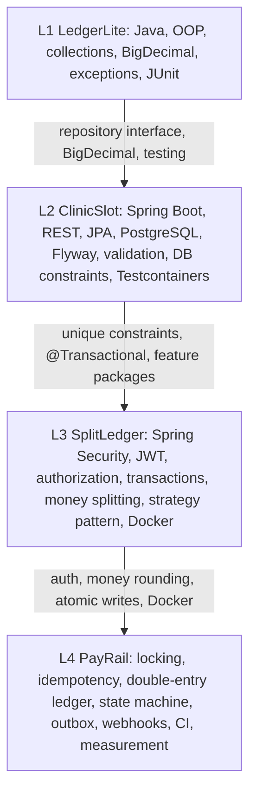

# Java and Spring Boot Backend Roadmap for SWE-1/SDE-1 Roles

## Design approach

- **Four projects, one application style.** Every level is a single deployable application.
- **One database.** PostgreSQL is used from Level 2 through Level 4.
- **Each level adds one main theme:**
  - L1: Java and object-oriented design
  - L2: REST, persistence and validation
  - L3: Security, authorization, transactions and money handling
  - L4: Correctness when requests run at the same time, retries and auditability
- **The Level 4 project is a fintech domain on purpose.** It's close to the kind of work done at Juspay, Razorpay, PhonePe, Paytm, JPMC and Goldman Sachs, so the interview discussion will feel familiar to them.

---

# LEVEL 1: `LedgerLite`, a command-line personal finance tracker

### 1. Description
A plain Java command-line app for recording income and expenses by category, setting monthly budgets and producing summaries saved to a file.

### 2. Why this level
There's no framework, database or HTTP. You learn Java itself: classes, collections, exceptions, file input/output, streams and unit tests. Spring hides these basics, so learn them first.

### 3. Real-world problem
Tracking where your money goes each month and seeing when you go over a budget.

### 4. User stories
- As a user, I can add, edit and delete a transaction (amount, type, category, date, note).
- As a user, I can set a monthly budget for each category.
- As a user, I can see a monthly summary: totals by category and budget overruns.
- As a user, I can quit and reopen the app without losing data.

### 5. Functional requirements
- Menu-driven command-line interface.
- Transactions and budgets are saved to CSV or JSON files.
- Filter by month, category and type.
- Report: income, expenses, net balance, top 3 categories, categories over budget.
- Export the report to a file.

### 6. Non-functional requirements
- Invalid input never crashes the app. It shows an error and asks again.
- Money is always `BigDecimal`, never `double`.
- Business logic is fully separated from console input and output.
- At least 80% test coverage on the service and domain classes.

### 7. Stack
Java 21, Maven, JUnit 5, Git/GitHub.

### 8. Why each technology
- **Java 21:** current long-term support version. You get records, `switch` expressions and `var`.
- **Maven:** the most common build tool in Indian enterprise and fintech teams. It teaches dependency management and the build lifecycle.
- **JUnit 5:** testing is expected from day one.
- **Git:** every interviewer will look at your commit history.

### 9. Avoid
Spring, databases, Lombok (write the boilerplate yourself once), GUI frameworks, Gradle (stick to one build tool).

### 10. Java concepts
Classes, interfaces, encapsulation, `enum`, `record`, `List`/`Map`/`Set`, `equals`/`hashCode`, `Comparator`, Streams API, `Optional`, checked vs. unchecked exceptions, custom exceptions, `java.time.LocalDate`/`YearMonth`, `BigDecimal` (scale and `RoundingMode`), try-with-resources, `Files`/`Path`, interface-based design (a `TransactionRepository` interface with a file implementation).

### 11. Database concepts
None directly. You do meet the ideas ahead of time: a repository abstraction, unique IDs and data integrity.

### 12. Security, validation, errors, logging, testing
- **Validation:** amount > 0; date not in the future; category is from the allowed list.
- **Errors:** custom `InvalidTransactionException` and `StorageException`. A corrupted file produces a clear message.
- **Logging:** `System.Logger` or `java.util.logging`, just enough to learn log levels.
- **Testing:** JUnit tests for the service and report logic. Use an in-memory repository as a fake.

### 13. Package structure
```
com.ledgerlite
 ├── domain        (Transaction, Category, TransactionType, Budget)
 ├── repository    (TransactionRepository, FileTransactionRepository, InMemory...)
 ├── service       (LedgerService, ReportService)
 ├── cli           (Menu, InputReader)
 └── exception
```

### 14. Entities
- `Transaction(id, amount, type, category, date, note)`
- `Budget(category, yearMonth, limit)`
- One category has many transactions; one category has one budget per month.

### 15. APIs
None. The menu actions are the "API": `add`, `list`, `edit`, `delete`, `set-budget`, `report`, `export`.

### 16. Milestones
1. Set up the Maven project and Git repo, with a first commit.
2. Write the domain classes and enums.
3. Add an in-memory repository and `LedgerService`, with tests.
4. Build the menu with input validation.
5. Write the report logic using streams, with tests.
6. Add file persistence behind the repository interface.
7. Handle errors for bad files and bad input.
8. Write the README.

### 17. Testing strategy
- **Unit tests:** service rules, report calculations, `BigDecimal` rounding, filtering.
- **Integration test:** a file repository round-trip using a `@TempDir` temporary folder.

### 18. Common beginner mistakes
- Using `double` for money.
- Putting everything in `main`.
- Swallowing exceptions.
- Never testing edge cases (empty month, zero budget).

### 19. Optional extensions
- *(Optional)* Recurring transactions.
- *(Optional)* Import from a bank-statement CSV.
- *(Optional)* Spending trend over the last 6 months.

### 20. Deployment
Build a runnable JAR with `mvn package`. Attach it to a GitHub Release.

### 21. README checklist
- What the app does and how to run it.
- Sample session output.
- Design decisions (why `BigDecimal`, why a repository interface).
- How to run the tests.

### 22. Interview talking points
- Why `BigDecimal` instead of `double`.
- The `equals`/`hashCode` contract.
- Checked vs. unchecked exceptions.
- How streams work.
- Why you program to an interface.

### 23. Resume
Don't put this on your resume. It's for learning only.

### 24. Done when
All user stories work, tests pass, no input crashes the app, and the README exists. Stop there. **Time: 1–2 weeks.**

---

# LEVEL 2: `ClinicSlot`, a clinic appointment booking REST API

### 1. Description
A Spring Boot REST API where clinics publish doctor schedules and patients book, reschedule and cancel appointments without double-booking.

### 2. Why this level
It adds Spring Boot, REST, JPA and PostgreSQL. It also has one real backend problem (preventing double-booking) instead of pure create/read/update/delete, and that problem introduces database constraints and transactions early. Security waits until Level 3 so there aren't too many new concepts at once.

### 3. Real-world problem
Small clinics manage slots by phone, which leads to double bookings and no-shows.

### 4. User stories
- As an admin, I can add doctors and define weekly availability (e.g., Mon 10:00–13:00, 15-minute slots).
- As a patient, I can see a doctor's free slots for a date.
- As a patient, I can book, reschedule or cancel an appointment.
- As an admin, I can list a doctor's appointments for a day, with pagination.
- As a patient, I can't book a past slot or a slot that's already taken.

### 5. Functional requirements
- Create/read/update/delete for doctors and patients.
- Availability rules generate slots on the fly (don't store every slot).
- Booking checks: slot is inside availability, in the future and not already taken.
- Cancellation is allowed only up to 2 hours before the appointment.
- Appointment statuses: `BOOKED → CANCELLED | COMPLETED`.
- Pagination and filtering on list endpoints.

### 6. Non-functional requirements
- A database unique constraint guarantees no double-booking, even if two requests arrive at the same time.
- Consistent error response format.
- Database schema is versioned.
- Documented API through Swagger.

### 7. Stack
Java 21, Spring Boot 3 (Web, Data JPA, Validation), PostgreSQL, Flyway, springdoc-openapi, JUnit 5, Mockito, Spring Boot Test, Testcontainers.

### 8. Why each technology
- **Spring Boot Web:** the industry standard for Java REST APIs.
- **Spring Data JPA / Hibernate:** the object-relational mapping used in most target companies' Java codebases.
- **PostgreSQL:** a real relational database with strong constraint support. It's what you'll use in production.
- **Flyway:** schema changes as versioned SQL files. Teams don't use `ddl-auto=update` in production.
- **Bean Validation:** declarative input checks on request objects.
- **springdoc-openapi:** Swagger UI, so you don't need a frontend.
- **Mockito:** isolates the service layer in unit tests.
- **Testcontainers:** tests run against real PostgreSQL. H2 behaves differently and hides bugs.

### 9. Avoid
Spring Security (Level 3), Redis, Docker for deployment (Level 3), microservices, MapStruct (map by hand to learn), H2 for tests.

### 10. Spring concepts
IoC/DI, constructor injection, `@RestController`, `@Service`, `@Repository`, request and response DTOs, `ResponseEntity`, `@Valid`, `@ControllerAdvice`, `@Transactional`, profiles (`application-dev.yml`), `Pageable`, layered architecture.

### 11. Database concepts
Primary and foreign keys, one-to-many, unique and composite constraints (`UNIQUE(doctor_id, start_time)`), indexes, normalization to third normal form, basic transactions, the N+1 query problem (seen and fixed with a fetch join), migrations.

### 12. Security, validation, errors, logging, testing
- **Validation:** `@NotBlank`, `@Email`, `@Future`, and a custom validator that checks the slot is aligned to the 15-minute grid.
- **Errors:** return RFC 7807 `ProblemDetail` responses. Map codes like this:
  - 404: not found
  - 409: slot taken (catch `DataIntegrityViolationException`)
  - 422: business rule violated
- **Logging:** SLF4J. Log at INFO for bookings and cancellations, WARN for conflicts. Never log patient phone numbers.
- **Security:** none yet. Say so in the README.

### 13. Package structure
Organize by feature, not by layer:
```
com.clinicslot
 ├── doctor        (Doctor, DoctorController, DoctorService, DoctorRepository, dto/)
 ├── patient
 ├── availability  (AvailabilityRule, SlotGenerator)
 ├── appointment   (Appointment, AppointmentStatus, AppointmentService, ...)
 └── common        (exception/, GlobalExceptionHandler, config/)
```

### 14. Entities
- `Doctor(id, name, specialization)`
- `Patient(id, name, email UNIQUE, phone)`
- `AvailabilityRule(id, doctor_id FK, day_of_week, start_time, end_time, slot_minutes)`
- `Appointment(id, doctor_id FK, patient_id FK, start_time, status, created_at)` with `UNIQUE(doctor_id, start_time) WHERE status='BOOKED'` (a partial unique index)

### 15. Endpoints
```
POST   /api/doctors
GET    /api/doctors?specialization=&page=
POST   /api/doctors/{id}/availability
GET    /api/doctors/{id}/slots?date=2026-10-01
POST   /api/appointments
PATCH  /api/appointments/{id}/reschedule
POST   /api/appointments/{id}/cancel
GET    /api/doctors/{id}/appointments?date=&page=
```

### 16. Milestones
1. Generate the project with Spring Initializr and connect to local PostgreSQL.
2. Add the first Flyway migration and the Doctor create/read/update/delete, with DTOs.
3. Add the global exception handler and validation.
4. Add Patient.
5. Add availability rules and the slot generator, with unit tests.
6. Add booking with the partial unique index, and handle the conflict.
7. Add cancel and reschedule with rules and the status transitions.
8. Add pagination and fix the N+1 query.
9. Write Testcontainers integration tests.
10. Add Swagger, a Postman collection and the README.
11. Deploy.

### 17. Testing strategy
- **Unit tests (Mockito):** slot generation, cancellation window, status transitions.
- **Integration tests (`@SpringBootTest` + Testcontainers + MockMvc):** booking flow, 409 on double-booking, validation errors returning 400, pagination.

### 18. Common beginner mistakes
- Returning entities directly from controllers.
- Using field injection.
- Using `ddl-auto=update`.
- Checking "is the slot free?" in Java only, without a database constraint. This check-then-insert pattern is a race condition.
- Ignoring time zones. Store `timestamptz` and use one clinic time zone.

### 19. Optional extensions
- *(Optional)* Doctor leave days that block slots.
- *(Optional)* A scheduled job that marks past appointments `NO_SHOW`.
- *(Optional)* CSV export of daily appointments.

### 20. Deployment
Use Render or Railway with managed PostgreSQL. Deploy the JAR directly. Configure it with environment variables.

### 21. README checklist
- Problem description and a simple entity-relationship diagram.
- How to run locally.
- Link to Swagger.
- Business rules.
- Explanation of how double-booking is prevented.
- Known limitations (no authentication).

### 22. Interview talking points
- How DI works in Spring.
- Why DTOs.
- What `@Transactional` does.
- Why a database constraint beats an application check.
- What N+1 is and how you fixed it.
- Why Flyway.
- Why Testcontainers instead of H2.

### 23. Resume
Optional. You can use one line in a "Projects" section if Level 4 isn't finished yet.

### 24. Done when
All endpoints work, the double-booking test passes, there are 15 or more meaningful tests, and it's deployed. **Time: 3–4 weeks.**

---

# LEVEL 3: `SplitLedger`, a group expense sharing and settlement API

### 1. Description
A secure, multi-user REST API for groups to record shared expenses, split them in several ways, track balances and suggest the fewest payments needed to settle up.

### 2. Why this level
It adds **authentication, per-resource authorization, multi-step transactions, money splitting and an algorithm**. Splitwise is also a common low-level design interview question, so this project doubles as interview practice.

### 3. Real-world problem
Roommates and trip groups argue over who owes whom. Rounding errors and unclear histories cause disputes.

### 4. User stories
- As a user, I can register and log in.
- As a user, I can create a group and invite members by email.
- As a member, I can add an expense split equally, by exact amounts or by percentage.
- As a member, I can see my net balance in each group and who I owe.
- As a member, I can record a settlement payment.
- As a member, I can see the suggested minimal settlement plan.
- As a non-member, I can't see or change a group's data.

### 5. Functional requirements
- Register and log in with JWT access tokens.
- Group roles: `OWNER` and `MEMBER`. Only the owner can remove members.
- Split validation: exact splits must add up to the total; percentages must add up to 100.
- Rounding: leftover paise go to the payer, deterministically, so the total always matches.
- An expense can be edited or deleted only by its creator. Deletion is a soft delete kept for history.
- Paginated activity feed for each group.
- Balances are computed from expenses and settlements, never stored as a single editable number.
- A member can leave the group only when their balance is zero.

### 6. Non-functional requirements
- Passwords are hashed with BCrypt.
- Every endpoint checks group membership. No insecure direct object references (IDOR).
- An expense and its splits are saved atomically.
- Runs locally with one command: `docker compose up`.

### 7. Stack
Level 2 stack plus **Spring Security**, **a JWT library (jjwt)** and **Docker with Docker Compose**.

### 8. Why each technology is new here
- **Spring Security:** authentication and authorization are expected in any backend interview.
- **JWT:** stateless authentication for a REST API. You should also be able to explain its downsides (hard to revoke tokens).
- **Docker and Compose:** one-command setup of the app plus PostgreSQL. Reviewers can run your project, and it's the minimum Docker knowledge SDE-1 roles expect.

### 9. Avoid
OAuth2 or Keycloak (too much for now), refresh-token rotation infrastructure, Redis, WebSockets for live balances, sending email (just log the invite link).

### 10. Spring concepts
Security filter chain, a custom `OncePerRequestFilter`, `UserDetailsService`, `PasswordEncoder`, method security (`@PreAuthorize` with a custom bean such as `@groupAuth.isMember(#groupId)`), `@AuthenticationPrincipal`, transaction propagation basics, the strategy pattern for split types, `@ConfigurationProperties`.

### 11. Database concepts
Many-to-many through a join entity (`GroupMember` with a role), aggregation queries (`SUM ... GROUP BY`), soft delete, audit columns, `NUMERIC(19,2)`, composite indexes for feed queries, transaction atomicity, how rollback behaves.

### 12. Security, validation, errors, logging, testing
- **Security:**
  - BCrypt password hashing.
  - JWT secret read from an environment variable.
  - Membership checked on every group resource.
  - Return 403 vs. 404 on purpose. Return 404 for groups the user isn't in, so the API doesn't reveal that they exist.
- **Validation:** custom validators that check split sums add up.
- **Errors:** responses for 401, 403, 409 and 422 all use `ProblemDetail`.
- **Logging:** add a request ID to MDC so it appears in every log line. Never log tokens or passwords.
- **Testing:** security tests with `@WithMockUser` and with real JWTs.

### 13. Package structure
```
com.splitledger
 ├── auth        (AuthController, JwtService, JwtFilter, SecurityConfig)
 ├── user
 ├── group       (Group, GroupMember, GroupRole, GroupAuthorization)
 ├── expense     (Expense, ExpenseSplit, split/ {SplitStrategy, EqualSplit, ExactSplit, PercentSplit})
 ├── settlement  (Settlement, BalanceService, SettlementPlanner)
 └── common
```

### 14. Entities
- `User(id, email UNIQUE, password_hash, name)`
- `Group(id, name, created_by)`
- `GroupMember(group_id, user_id, role, joined_at)` with primary key `(group_id, user_id)`
- `Expense(id, group_id, paid_by, amount, description, split_type, created_by, deleted_at, created_at)`
- `ExpenseSplit(id, expense_id, user_id, share_amount)`
- `Settlement(id, group_id, from_user, to_user, amount, created_at)`

### 15. Endpoints
```
POST /api/auth/register | /api/auth/login
POST /api/groups                         GET /api/groups
POST /api/groups/{id}/members            DELETE /api/groups/{id}/members/{userId}
POST /api/groups/{id}/expenses           GET /api/groups/{id}/expenses?page=
PUT/DELETE /api/groups/{id}/expenses/{expenseId}
GET  /api/groups/{id}/balances
GET  /api/groups/{id}/settlement-plan
POST /api/groups/{id}/settlements
```

### 16. Milestones
1. User registration with BCrypt.
2. Login that issues a JWT, and the JWT filter.
3. Groups and membership, plus the authorization bean.
4. Equal splits with the rounding rule, with unit tests.
5. Exact and percentage splits using the strategy pattern.
6. Balance queries.
7. Settlement planner: greedy matching of the largest debtor with the largest creditor, with tests.
8. Settlements and the activity feed.
9. Soft delete and edit rules.
10. Security integration tests, including one that tries to access another user's group.
11. Dockerfile and Compose file.
12. Deploy and write the README.

### 17. Testing strategy
- **Unit tests:** each split strategy (including rounding: ₹100 split among 3 people), settlement planner (sum stays the same, no one pays themselves), balance maths.
- **Integration tests:** the full flow from registration to settlement, 401 without a token, 404 or 403 for another group's data, rollback when splits are invalid.

### 18. Common beginner mistakes
- Checking authentication but not authorization. This is the IDOR bug.
- Storing a mutable `balance` column that gets out of sync.
- Letting splits drift by a paisa because of rounding.
- Hardcoding the JWT secret.
- Claiming the settlement planner is "optimal". The greedy approach isn't guaranteed to give the minimum number of payments; the exact problem is NP-hard. Say so.

### 19. Optional extensions
- *(Optional)* Recurring expenses.
- *(Optional)* CSV export of group history.
- *(Optional)* Invite tokens that expire.

### 20. Deployment
Build a Docker image and deploy it to Render or Railway with managed PostgreSQL.

### 21. README checklist
- Architecture diagram.
- Authentication flow diagram.
- Rounding policy.
- Settlement algorithm and its complexity.
- Security model.
- `docker compose up` instructions.

### 22. Interview talking points
- The JWT request lifecycle through the filter chain.
- Authentication vs. authorization.
- How you prevented IDOR.
- Why balances are derived rather than stored.
- The rounding strategy.
- Strategy pattern.
- Greedy settlement and its complexity.
- Transaction rollback.

### 23. Resume bullets
- Built a Spring Boot and PostgreSQL expense-sharing API with JWT authentication and group-level role-based authorization; integration tests confirm non-members can't access group data.
- Implemented equal, exact and percentage split strategies with deterministic paisa rounding, covered by N unit tests (use your real count).

### 24. Done when
All user stories work, the authorization tests pass, `docker compose up` works on a clean machine, and it's deployed. **Time: 4–5 weeks.**

---

# LEVEL 4: `PayRail`, a merchant wallet and payment ledger service

### 1. Description
A payment backend where customers top up wallets and pay merchants, and merchants get refunds, payouts and signed webhooks. A double-entry ledger records every movement, and the system stays correct under simultaneous requests and client retries.

### 2. Why this level
The difficulty is **correctness**, not the number of tools:
- Idempotency
- Row locking for requests that happen at the same time
- Double-entry accounting
- A payment state machine
- Reliable webhook delivery with retries
- Reconciliation

These are the problems Razorpay, Juspay and PhonePe engineers deal with daily, shrunk to a size one person can build. It's still one app with one database.

### 3. Real-world problem
Payment systems must never lose or duplicate money:
- A network timeout followed by a client retry must not charge the customer twice.
- Two simultaneous payments must not overdraw a wallet.
- Merchants must reliably learn the final status of each payment.

### 4. User stories
- As a customer, I can top up my wallet (simulated funding source).
- As a customer, I can pay a merchant. Retrying with the same `Idempotency-Key` returns the original result.
- As a merchant, I can create an order, see its payments and issue full or partial refunds.
- As a merchant, I receive signed webhooks for `payment.succeeded` and `refund.processed`, with retries if my endpoint fails.
- As a merchant, I can request a payout of my settled balance.
- As an admin or operator, I can run a reconciliation report that proves every ledger balances.
- As an auditor, I can see a history of every balance change that can't be modified.

### 5. Functional requirements
- **Accounts:** customer wallets, merchant accounts and system accounts (`FUNDING_SOURCE`, `PAYOUT_CLEARING`).
- **Double-entry ledger:** every transfer creates two or more `LedgerEntry` rows whose debits equal their credits. Rows are never updated or deleted.
- **Balances:** a cached `balance` column on `Account`, updated in the same transaction as the ledger entries and checked by reconciliation.
- **Payment state machine:** `CREATED → PROCESSING → SUCCEEDED | FAILED`, and `SUCCEEDED → PARTIALLY_REFUNDED → REFUNDED`. Illegal transitions are rejected.
- **Idempotency:** the `Idempotency-Key` header is required on payment, refund and payout requests.
  - Keys are stored with a hash of the request body and the saved response.
  - Same key with a different body returns 422.
  - Same key while the first request is still running returns 409.
- **Refunds:** the total refunded can never exceed the amount captured.
- **Webhooks:**
  - An event row is written *in the same transaction* as the payment. This is the transactional outbox pattern, using the same database.
  - A `@Scheduled` worker delivers events, signed with HMAC-SHA256.
  - Retries use exponential backoff, up to 6 attempts, then the event is marked `DEAD`.
- **Reconciliation endpoint:** checks total debits = total credits, that each account's balance equals the sum of its entries, and that no payment is stuck in `PROCESSING` for more than N minutes.
- **Authentication:** JWT for customers. API keys (hashed) for merchants.

### 6. Non-functional requirements
- **No lost or duplicated money when requests overlap.** Proven by a test that fires 50 payments at once from one wallet with a balance that only covers 20. Exactly 20 must succeed and the balance must end at zero, never negative.
- **Idempotency under retries.** Proven by a test that sends the same key 10 times in parallel. Exactly 1 ledger transfer is created.
- **Measured latency.** One simple k6 load test reports p50 and p95 latency for `POST /payments` on your hardware. Report the measured numbers exactly as they are.
- **Auditability.** Ledger rows can only be inserted, and there are audit timestamps everywhere.
- **Observability.** Actuator health endpoint, structured logs with request ID, payment ID and merchant ID.
- **CI.** Every push builds the project and runs all tests, including Testcontainers.

### 7. Stack
Level 3 stack plus **Spring Boot Actuator**, **GitHub Actions** and **k6** (for measurement only).

### 8. Why each technology is new here
- **Actuator:** health and metrics endpoints are the minimum for a production-style service.
- **GitHub Actions:** proves the tests pass on every commit, which backs up your resume claims.
- **k6:** the only honest way to state a latency number. One script is enough.
- **Deliberately *not* new:**
  - Locking uses PostgreSQL's `SELECT ... FOR UPDATE` (through `@Lock(PESSIMISTIC_WRITE)`), not Redis.
  - Idempotency uses a PostgreSQL unique constraint, not Redis.
  - Webhooks use a database outbox with `@Scheduled`, not Kafka.
  - You must be able to explain *why* each of these is enough at this scale.

### 9. Avoid
Kafka/RabbitMQ, Redis, microservices, Kubernetes, real payment gateway integration, distributed transactions/sagas, a separate ledger database, event sourcing, anything based on floating-point numbers.

### 10. Spring concepts
Transaction isolation levels, `@Lock`, `@Version` optimistic locking (used for merchant settings), the `@Transactional` self-invocation pitfall, `@Scheduled` with `SKIP LOCKED` polling, `RestClient` with timeouts, a custom `HandlerInterceptor` or filter for idempotency, multiple security filter chains (JWT and API key), Actuator, `@ConfigurationProperties`, an enum-based state machine.

### 11. Database concepts
- Pessimistic vs. optimistic locking.
- Avoiding deadlocks by always locking accounts in ascending ID order.
- Isolation levels (READ COMMITTED vs. REPEATABLE READ) and the anomalies each one allows.
- `FOR UPDATE SKIP LOCKED` for the job queue.
- Unique constraints used as idempotency guards.
- `CHECK` constraints (`balance >= 0`, `amount > 0`).
- Append-only tables.
- Reading query plans with `EXPLAIN ANALYZE` for ledger queries, with index justification.

### 12. Security, validation, errors, logging, testing
- **Security:**
  - Merchant API keys stored as SHA-256 hashes and shown only once.
  - HMAC-signed webhooks with a timestamp to stop replayed requests.
  - Customers can only access their own wallet.
  - Merchants can only see their own orders.
- **Validation:** amount limits, currency is INR only, refund amount ≤ amount still refundable.
- **Errors:** stable machine-readable error codes (`INSUFFICIENT_FUNDS`, `IDEMPOTENCY_KEY_REUSED`, `INVALID_STATE_TRANSITION`).
- **Logging:** structured JSON logs with `requestId`, `paymentId` and `merchantId`. Never log API keys, card-like data or full tokens.
- **Testing:** see section 17. Concurrency tests are required.

### 13. Package structure
A modular monolith, with each module exposing only its service interface:
```
com.payrail
 ├── identity     (customers, merchants, API keys, JWT)
 ├── account      (Account, AccountService)
 ├── ledger       (LedgerTransfer, LedgerEntry, LedgerService — the only writer of balances)
 ├── payment      (Order, Payment, PaymentStateMachine, PaymentService)
 ├── refund
 ├── payout
 ├── idempotency  (IdempotencyRecord, IdempotencyFilter)
 ├── webhook      (OutboxEvent, WebhookDispatcher, HmacSigner)
 ├── reconciliation
 └── common
```
Rule: only `ledger` changes balances. Document this, and enforce it in code review (optionally with an ArchUnit test).

### 14. Entities
- `Account(id, owner_type, owner_id, type, balance NUMERIC CHECK >= 0, version)`
- `LedgerTransfer(id, reference_type, reference_id, created_at)`, which is one business event
- `LedgerEntry(id, transfer_id FK, account_id FK, direction DEBIT/CREDIT, amount)`, append-only
- `Merchant(id, name, webhook_url, webhook_secret)`
- `ApiKey(id, merchant_id, key_hash UNIQUE, created_at, revoked_at)`
- `Order(id, merchant_id, amount, status)`
- `Payment(id, order_id, customer_account_id, amount, status, refunded_amount, created_at)`
- `Refund(id, payment_id, amount, status)`
- `Payout(id, merchant_id, amount, status)`
- `IdempotencyRecord(key, owner_id, request_hash, status, response_code, response_body, created_at)` with `UNIQUE(owner_id, key)`
- `OutboxEvent(id, merchant_id, event_type, payload, status, attempts, next_attempt_at)`

**Invariant:** for every transfer, the sum of debits equals the sum of credits.

### 15. Endpoints
```
POST /api/customers/register | /api/customers/login
POST /api/wallet/topups                 (Idempotency-Key)
GET  /api/wallet                        GET /api/wallet/transactions?page=
POST /api/merchants/orders              (API key)
POST /api/payments                      (JWT, Idempotency-Key)
GET  /api/merchants/payments/{id}
POST /api/merchants/payments/{id}/refunds   (Idempotency-Key)
POST /api/merchants/payouts                 (Idempotency-Key)
GET  /api/merchants/webhooks/events?status=
POST /api/admin/reconciliation/run
GET  /actuator/health
```

### 16. Milestones
1. Accounts and the ledger service with the double-entry invariant, plus unit tests.
2. Wallet top-up through a transfer from the funding account.
3. Payment state machine, with unit tests covering all transitions.
4. Payment flow with `FOR UPDATE` locking in consistent ID order.
5. **Concurrency test:** 50 parallel payments. See it fail without locks, then pass with them. Record both results.
6. Idempotency records, plus the parallel-retry test.
7. Merchant API keys and the second security filter chain.
8. Refunds, including partial refunds and their limits.
9. Outbox table written in the same transaction, and the dispatcher using `SKIP LOCKED`, backoff and HMAC.
10. Payouts.
11. Reconciliation job.
12. Actuator, structured logs and request IDs.
13. GitHub Actions CI.
14. k6 run; record p50/p95 and the hardware in the README.
15. Deploy, then write the README and architecture decision records (ADRs).

### 17. Testing strategy
- **Unit tests:** state machine transitions, ledger invariant, HMAC signing, backoff calculation, refund limits, idempotency request hashing.
- **Integration tests (Testcontainers):**
  - Full payment → refund → webhook flow, with the merchant endpoint stubbed by a simple local HTTP server or MockWebServer.
  - Insufficient funds.
  - Illegal state transitions.
  - Webhook retries ending in `DEAD`.
  - Reconciliation detecting a manually corrupted balance.
- **Concurrency tests:** use `ExecutorService` and `CountDownLatch`:
  - Parallel payments never overdraw the wallet.
  - Parallel idempotent retries produce one transfer.
  - Two opposite transfers running at once don't deadlock.
- **Load measurement:** k6, reported as numbers only, not as a test that passes or fails.

### 18. Common beginner mistakes
- Updating a balance without a ledger entry.
- Locking accounts in random order, which causes deadlocks.
- Calling the webhook HTTP endpoint *inside* the database transaction.
- Saving the idempotency record only after processing, which lets two identical requests both go through.
- Calling a `@Transactional` method from within the same class, so the annotation has no effect.
- Claiming "exactly-once" webhooks. Delivery is *at-least-once*, and merchants must remove duplicates using the event ID.
- Letting the scope grow into UPI, cards or a gateway integration.

### 19. Optional extensions
- *(Optional)* Daily settlement batch that moves merchant balances from pending to available (T+1).
- *(Optional)* Per-merchant rate limiting with a simple token bucket held in memory, with its single-instance limitation documented.
- *(Optional)* Webhook replay endpoint for `DEAD` events.

### 20. Deployment
One Docker image on Render, Railway or Fly.io with managed PostgreSQL. Secrets go in environment variables. CI runs the tests; deploying can be manual. Don't use AWS ECS or Kubernetes.

### 21. README checklist
- Problem statement and scope, including what's deliberately left out.
- Architecture diagram of the modules.
- Entity-relationship diagram.
- Sequence diagrams for payment and webhook delivery.
- **Correctness section:** locking strategy, idempotency design, ledger invariant, outbox pattern. Each links to the test that proves it.
- ADRs: why PostgreSQL locks instead of Redis, why an outbox instead of Kafka, why a monolith.
- k6 results with the hardware and dataset.
- Instructions to run locally and to run the tests.
- Known limitations.
- Postman collection and Swagger link.

### 22. Interview talking points
- The full path of a payment request: filter → idempotency → transaction → lock → ledger → outbox.
- Why double-entry accounting.
- Pessimistic vs. optimistic locking, and why you chose pessimistic for wallets.
- How you avoid deadlocks.
- Isolation levels.
- Why at-least-once delivery, and what the consumer must do about duplicates.
- What breaks if you run 2 instances, and how to fix it. (The in-memory rate limiter breaks. The scheduler is already safe because of `SKIP LOCKED`.)
- What you'd change at 100× traffic. Discuss it honestly rather than claiming it's built.

### 23. Resume bullets
Fill in your real numbers.
- Built a Spring Boot and PostgreSQL wallet and payment service with a double-entry ledger. A concurrency test of 50 parallel payments shows no overdrafts or lost updates, using row-level locking in consistent order.
- Implemented idempotent payment, refund and payout APIs using PostgreSQL unique constraints. Parallel retry tests confirm a single ledger transfer per idempotency key.
- Delivered HMAC-signed merchant webhooks through a transactional outbox with exponential-backoff retries. Measured p95 latency of X ms at Y requests/sec with k6 on a local machine. CI runs N+ tests on every commit.

### 24. Done when
- All user stories work.
- The three concurrency tests pass in CI.
- Reconciliation reports zero mismatches after the load test.
- The README correctness section and ADRs are written.
- It's deployed.

Then **stop**. Don't add Kafka, Redis or microservices. **Time: 6–8 weeks.**

---

## A. Dependency map



## B. Minimum technologies for the whole roadmap
Java 21, Maven, Git/GitHub, Spring Boot 3 (Web, Data JPA, Validation, Security, Actuator), PostgreSQL, Flyway, JWT (jjwt), springdoc-openapi, JUnit 5, Mockito, Testcontainers, Docker and Docker Compose, GitHub Actions, k6, Postman.

## C. Technologies intentionally excluded, and why

| Excluded | Reason |
|---|---|
| Microservices | One developer and one domain. A monolith is simpler, and the modules still give clear boundaries. |
| Kafka / RabbitMQ | A database outbox with `@Scheduled` gives reliable delivery at this scale. |
| Redis | PostgreSQL already handles locks, idempotency and queues. Adding Redis means two sources of truth. |
| Kubernetes, service mesh | This is infrastructure work, not SDE-1 backend work. |
| GraphQL | REST is the standard for payment APIs. |
| Elasticsearch | No full-text search is needed. |
| CQRS / event sourcing | The append-only ledger already gives auditability without that complexity. |
| Multiple databases | You'd face consistency problems with no benefit. |
| Lombok, MapStruct | Optional convenience only. Learn the underlying code first. Adding them later is fine. |
| OAuth2 / Keycloak | JWT and API keys are enough to show you understand authentication. |
| AWS / GCP managed services | A PaaS deploy shows the same skills with less complexity. |
| H2 | It behaves differently from PostgreSQL and hides bugs. |

## D. Learning order
1. **Git**, alongside core Java (week 1, and keep using it every day)
2. **Core Java**, through Level 1
3. **SQL**: joins, aggregates, indexes and constraints in plain PostgreSQL, before JPA
4. **Spring Boot** with JPA, through Level 2
5. **Testing**: JUnit and Mockito from Level 1; Testcontainers in Level 2
6. **Security**, in Level 3
7. **Docker**, late in Level 3
8. **Deployment**: PaaS from Level 2; Docker-based deploy and CI in Levels 3–4

## E. Interview topics the projects cover
- **REST:** design, status codes, DTOs, validation, global error handling.
- **Spring:** DI and IoC, the `@Transactional` proxy and its pitfalls, JPA relationships, N+1, pagination.
- **Database:** constraints, indexes, `EXPLAIN`, transactions, isolation levels, pessimistic vs. optimistic locking, deadlocks.
- **Security:** authentication vs. authorization, JWT, BCrypt, IDOR, API key hashing, HMAC.
- **Payments and reliability:** idempotency, state machines, double-entry accounting, outbox pattern, at-least-once delivery, retries with backoff.
- **Design patterns:** strategy, repository.
- **Engineering practice:** testing pyramid, Testcontainers, concurrency testing, Docker basics, CI.

## F. Topics that still need separate study
- **DSA:** arrays, hashing, two pointers, sliding window, trees, graphs, heaps, dynamic programming. Aim for about 200–300 LeetCode problems. This is the biggest filter at Juspay, Razorpay, Goldman Sachs and Swiggy.
- **Core Java:** JVM memory, garbage collection basics, how `HashMap` works internally, `String` immutability, generics, the collections framework, multithreading (`synchronized`, `volatile`, `ExecutorService`, `CompletableFuture`), Java 8+ features.
- **SQL:** window functions, complex joins, practice queries on HackerRank or LeetCode.
- **DBMS:** ACID, normalization, how B-tree indexes work, isolation anomalies.
- **Operating systems:** processes vs. threads, scheduling, deadlocks, memory and paging.
- **Computer networks:** TCP vs. UDP, HTTP/HTTPS, TLS basics, DNS, what happens when you type a URL.
- **OOP and SOLID principles.**
- **Low-level design:** parking lot, Splitwise (you'll have built it), rate limiter, LRU cache, elevator.
- **Basic system design:** load balancers, caching, database replication vs. sharding, URL shortener. Only at a conceptual level.
- **Behavioral:** STAR-format stories built from your project decisions.

## G. Reality check
- **Is Level 4 enough?** Yes, for SDE-1, *as long as you can defend every line*. Most freshers show create/read/update/delete apps. A project with concurrency tests that prove correctness, idempotency and a ledger invariant stands out, especially at fintech companies. Fintech interviewers often ask about idempotency and double-spending anyway.
- **It won't get you through on its own.** At Juspay, Razorpay, Goldman Sachs and similar companies, DSA and core Java rounds usually decide whether you get to the project discussion. Split your time roughly 50% DSA/computer science fundamentals and 50% projects.
- **Level 4 is simplified on purpose.** It has no real payment rails, it runs as a single instance and the numbers are from local measurement. Say this before the interviewer does. Knowing the limits of your design is itself a signal of seniority.

**Audit results:**
- Can a beginner complete the levels in order? Yes. There are about 3–5 new concepts per level, over roughly 14–19 weeks in total.
- Does every technology solve a concrete problem? Yes. Each one is justified in section 8 of its level.
- Is Level 4 impressive because of depth rather than tool count? Yes. It adds only 3 tools over Level 3, and one of them (k6) is just for measurement.
- Can every resume claim be backed up? Yes. Each bullet points to a named test, a CI run or a k6 report. Fill in the real numbers before you use them.
